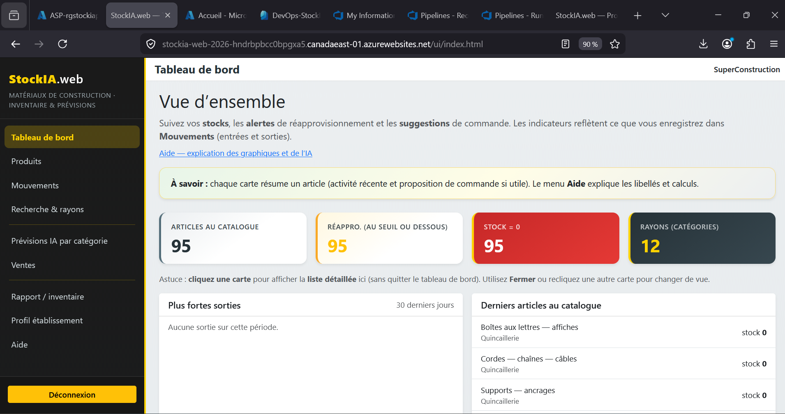
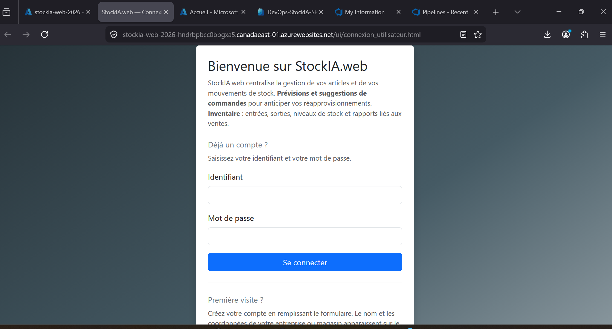
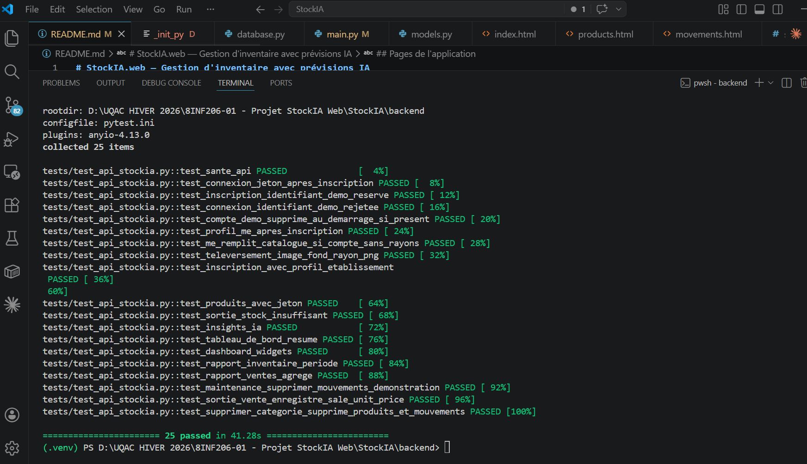
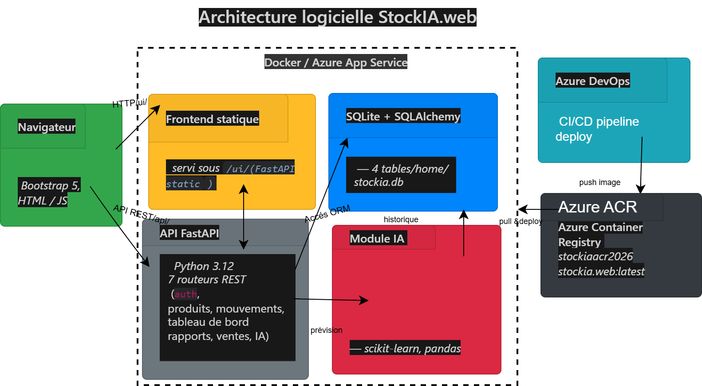
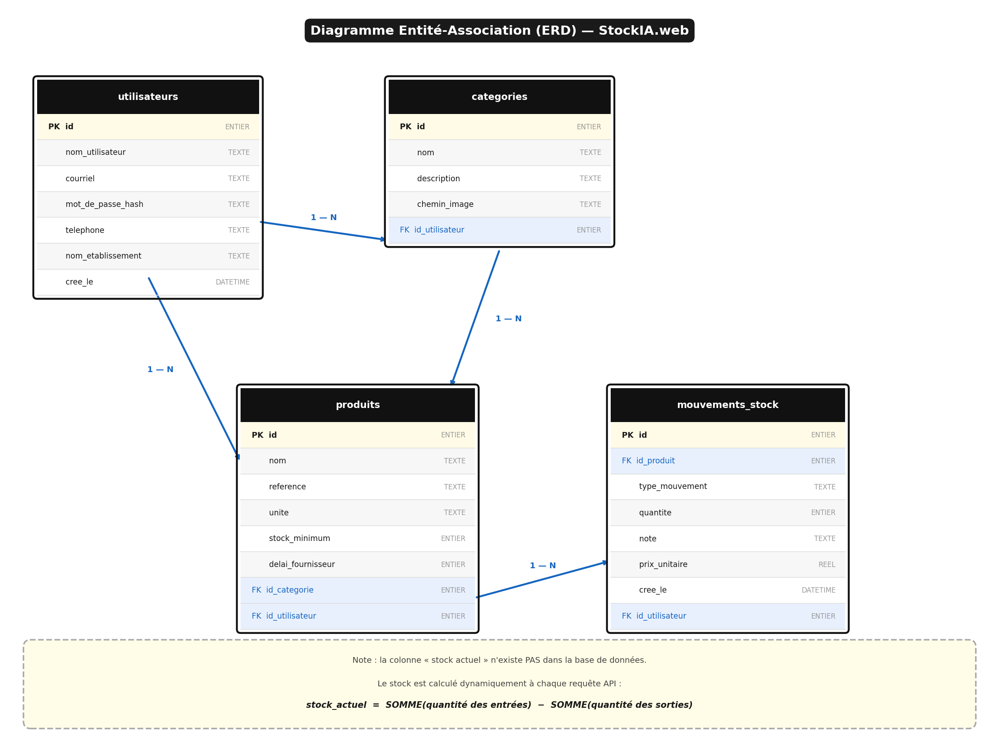

# StockIA.web — Gestion d'inventaire avec prévisions IA

[](https://github.com/thieramadou98-afk/stockia-forecasting-api/actions/workflows/tests.yml)

Application web de gestion de stock pour un petit commerce, avec des prévisions de consommation qui indiquent quand et combien recommander.

Projet de session du cours 8INF206 (Université du Québec à Chicoutimi, hiver 2026), réalisé seul. L'application a été pensée pour un magasin de matériaux de construction.



## Fonctionnalités

- Gestion des rayons (catégories) et des articles
- Entrées de stock (réceptions) et sorties (ventes, pertes)
- Tableau de bord avec alertes de stock bas et graphiques
- Prévision de consommation par article, avec point de commande et quantité à commander
- Rapport d'inventaire sur une période choisie, imprimable
- Synthèse des ventes
- Comptes utilisateurs avec authentification : chaque utilisateur voit seulement ses propres rayons et articles

À la création d'un compte, un catalogue de départ est généré (12 rayons et environ 95 articles) pour pouvoir essayer l'application tout de suite.

## Comment les prévisions sont calculées

Les prévisions partent de l'historique des sorties de chaque article, regroupées par jour avec pandas.

1. **Consommation journalière estimée.** Avec moins de 3 jours d'historique, on prend la moyenne simple. Sinon, on combine une régression linéaire (45 %), une moyenne mobile sur 5 jours (30 %) et une forêt aléatoire (25 %). La forêt aléatoire n'entre en jeu qu'à partir de 10 jours d'historique.
2. **Demande de référence.** C'est le plus grand des deux chiffres suivants : la moyenne des 14 derniers jours et la consommation estimée. On veut une recommandation prudente.
3. **Point de commande.** Demande de référence × délai d'approvisionnement de l'article (7 jours par défaut), plus un stock de sécurité de 1,28 × écart-type des sorties × √délai, ce qui correspond à un niveau de service d'environ 90 %. Le stock minimum de l'article sert de plancher.
4. **Quantité recommandée.** On vise le point de commande plus 7 jours de demande, moins le stock actuel.
5. **Risque de rupture** (faible, moyen ou élevé), selon le stock restant en jours de demande et la position par rapport au point de commande.

Le script `ia/evaluer_modele_demo.py` compare la régression linéaire et la forêt aléatoire sur une série synthétique de 40 jours (30 pour l'entraînement, 10 pour le test, séparés dans l'ordre chronologique) et affiche l'erreur moyenne absolue (MAE) de chacune.

## Technologies

| | |
|---|---|
| Backend | Python 3.12, FastAPI, SQLAlchemy 2 |
| Base de données | SQLite |
| Authentification | JWT (python-jose), mots de passe hachés avec bcrypt |
| Prévisions | pandas, NumPy, scikit-learn |
| Interface | HTML, JavaScript, Bootstrap 5 |
| Tests | pytest |
| Déploiement | Docker, Azure DevOps, Azure App Service |

## Lancer le projet

```bash
cd backend
python -m venv .venv
.venv\Scripts\Activate.ps1        # Windows PowerShell
# source .venv/bin/activate       # Linux ou macOS
pip install -r requirements.txt
uvicorn app.main:app --reload
```

Ouvrir ensuite http://localhost:8000, qui redirige vers la page de connexion. Pour créer un compte, cliquer sur « Première visite ? ». La documentation interactive de l'API est sur http://localhost:8000/docs.

La clé secrète des jetons se règle avec la variable d'environnement `STOCKIA_SECRET_KEY` (voir `backend/env.example`). Une valeur par défaut sert en local, mais il faut la remplacer en production.

## Tests

```bash
cd backend
pytest -v
```

Les 25 tests couvrent l'inscription et la connexion, le profil du magasin, les produits et leur protection par jeton, le refus d'une sortie quand le stock est insuffisant, les prévisions, le tableau de bord et les rapports. Ils utilisent une base SQLite séparée et sont lancés automatiquement sur GitHub à chaque envoi.

## Structure

```
backend/
  app/            API FastAPI : routeurs, modèles, schémas, sécurité, service de prévisions
  tests/          tests automatisés
  requirements.txt
frontend/         pages HTML et JavaScript servies par l'API sous /ui/
ia/               script d'évaluation des modèles
docs/images/      diagrammes et captures d'écran
Dockerfile
azure-pipelines.yml
```

## Déploiement

L'application est empaquetée dans une seule image Docker (API et interface). Le pipeline `azure-pipelines.yml` construit l'image, l'envoie dans Azure Container Registry, puis met à jour l'App Service. Les noms des ressources (abonnement, registre, application) sont à adapter dans les variables du fichier.

Réglages à faire dans l'App Service :

| Variable | Valeur |
|---|---|
| `WEBSITES_PORT` | `8000` |
| `STOCKIA_SECRET_KEY` | une longue chaîne aléatoire |
| `WEBSITES_ENABLE_APP_SERVICE_STORAGE` | `true`, pour que la base SQLite survive aux redéploiements |

| Page de connexion sur Azure | Tests |
|---|---|
|  |  |

## Conception

| Architecture | Modèle de données |
|---|---|
|  |  |

## Limites et améliorations possibles

- SQLite convient pour un projet de cours, mais PostgreSQL serait préférable pour plusieurs magasins en parallèle.
- Les pondérations des trois modèles de prévision sont fixes. On pourrait les ajuster à partir de l'erreur mesurée sur chaque article.
- Les prévisions n'ont pas de composante saisonnière, alors que la demande en matériaux de construction en a une forte.
- Le niveau de service du stock de sécurité (90 %) est fixé dans le code.
